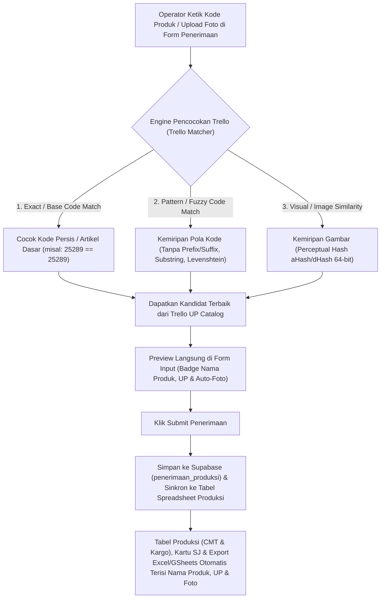

# Plan: Auto-Lookup Nama Produk, UP & Foto Produksi dari Data Trello UP

> **Status Plan**: `⏳ PENDING REVIEW / BELUM DIKERJAKAN`  
> **Tanggal Dibuat**: 2026-11-08  
> **Modul Terkait**: Penerimaan Produksi (`PenerimaanProduksiView.tsx`, `ProduksiSpreadsheetView.tsx`) & Trello UP (`trelloSyncService.ts`)

---

## 1. Latar Belakang & Kondisi Saat Ini
Saat ini di aplikasi WMS terdapat 2 sumber data yang sebenarnya saling berhubungan namun **belum saling mengintip secara otomatis**:
1. **Modul Trello UP** ([`trelloSyncService.ts`](file:///d:/Antigravity/WMS%20Inventory/src/services/trelloSyncService.ts) & tabel Supabase `trello_up_catalog`):
   - Menyimpan seluruh daftar kartu dari board Trello (`UPLOAD 2026 NEW`) lengkap dengan:
     - `item_code` (contoh: `25289`, `958`, `622289`)
     - `item_name` (contoh: `Ravelia Top`, `Quincy Skirt`)
     - `up_code` / `list_name` (contoh: `UP 279`, `UP 280 - 13 SEPT`)
     - `gdrive_image_url` / `trello_image_url` (foto produk)
2. **Modul Penerimaan Produksi** ([`PenerimaanProduksiView.tsx`](file:///d:/Antigravity/WMS%20Inventory/src/components/PenerimaanProduksiView.tsx) & [`ProduksiSpreadsheetView.tsx`](file:///d:/Antigravity/WMS%20Inventory/src/components/penerimaan/ProduksiSpreadsheetView.tsx)):
   - Saat operator menginput **Form Penerimaan**, operator hanya mengetik `Kode Produk` (misal `25289`), `Catatan`, `Foto`, dan matriks `Warna/Size`.
   - Di **Tabel Spreadsheet Produksi** ([`ProduksiSpreadsheetView.tsx`](file:///d:/Antigravity/WMS%20Inventory/src/components/penerimaan/ProduksiSpreadsheetView.tsx#L308-L332)):
     - Pada tab **Kargo**, kolom `PRODUCT NAME` dan `UP` saat ini masih di-*hardcode* kosong (`''`).
     - Pada tab **CMT**, `PRODUCT NAME` hanya mencari dari `Master Produk` gudang (padahal barang baru datang dari produksi sering kali belum masuk Master Produk gudang, melainkan baru ada di Trello UP), dan kolom `UP` hanya terisi `'BIS'` atau manual jika ada teks `UP:...` di catatan.

---

## 2. Alur Kerja (Flow) yang Diusulkan

Berikut adalah alur otomatis dari hulu ke hilir yang bisa kita terapkan:

### Tahap 1: Saat Mengetik di Form Penerimaan (Real-time Auto-Peek)
1. Begitu operator mengetik **Kode Produk** (misal `25289` atau `25289A`) di [`PenerimaanProduksiView.tsx`](file:///d:/Antigravity/WMS%20Inventory/src/components/PenerimaanProduksiView.tsx#L2280-L2287):
   - Sistem langsung mengintip kamus data Trello (`trello_up_catalog` dari memori lokal / Supabase).
   - Di bawah kolom Kode Produk langsung muncul **Preview Chip Otomatis**:
     - Contoh: `✨ Trello Match: Ravelia Top • UP 279 (4 SEPT)`
   - Jika operator **belum mengupload foto**, sistem otomatis menawarkan/mengisi foto produk dari kartu Trello tersebut (`gdrive_image_url` / `trello_image_url`).
   - Jika ada **lebih dari 1 UP** untuk kode yang sama (misal barang *repeat order* di `UP 275` dan `UP 280`), sistem memprioritaskan **UP paling baru**, disertai dropdown kecil jika operator ingin memilih UP lain.
2. **Bagaimana jika Kode Produk berbeda/typo, tapi operator menempel (Paste/Upload) Gambar?**
   - Saat gambar di-upload/paste ke blok produk, sistem menghitung *Visual Fingerprint* (`dHash` 64-bit via HTML5 Canvas) dan membandingkannya dengan gambar-gambar di Trello UP.
   - Jika ditemukan kemiripan gambar tinggi (atau kemiripan pola kode), sistem menampilkan saran: *"Mirip dengan Trello: 25289 - Ravelia Top (UP 279) — Gunakan?"*

### Tahap 2: Saat Klik "Simpan Semua Penerimaan" (Submit Interceptor)
Saat tombol submit ditekan di [`handleSubmitPenerimaan`](file:///d:/Antigravity/WMS%20Inventory/src/components/PenerimaanProduksiView.tsx#L1384-L1540):
1. Untuk setiap blok produk yang di-submit, sistem menjalankan fungsi `resolveProduksiTrelloMetadata(kode_produksi, foto_url, catatan)`.
2. Sistem melengkapi:
   - **`nama_produk`**: Diambil dari `item_name` Trello (atau fallback ke `productCatalog` jika di Trello tidak ada).
   - **`up_code` (UP)**: Diambil dari `up_code` Trello (misal `UP 279`) dan disimpan secara terstruktur (baik di field `nama_produk` / metadata `keterangan` dengan tag `UP:UP 279 | NAMA:Ravelia Top` maupun kolom tabel sehingga aman tanpa merusak skema yang ada).
   - **`foto_url`**: Jika operator tidak melampirkan foto saat input, otomatis diwarisi dari `gdrive_image_url` Trello.
3. Data yang sudah lengkap ini langsung dikirim ke Supabase (`penerimaan_produksi`) dan Google Sheet Produksi.

### Tahap 3: Auto-Enrichment pada Data Tabel Produksi yang Sudah Ada (Riwayat & Spreadsheet)
Agar data penerimaan lama yang **sudah terlanjur diinput sebelumnya** juga langsung terisi tanpa harus input ulang:
1. Pada [`ProduksiSpreadsheetView.tsx`](file:///d:/Antigravity/WMS%20Inventory/src/components/penerimaan/ProduksiSpreadsheetView.tsx#L308-L332) (baik tab **Lokal CMT** maupun **Kargo**):
   - Jika `productName` atau `upVendor` atau `photoUrl` pada blok tabel masih kosong, sistem otomatis me-lookup ke kamus **Trello UP Catalog** secara $O(1)$ / *fast-lookup*.
   - Dengan demikian, kolom **`PRODUCT NAME`**, **`UP`**, dan **`PHOTO`** pada Tabel Matriks Produksi (CMT & Kargo), Kartu Surat Jalan ([`PenerimaanProductCardItem.tsx`](file:///d:/Antigravity/WMS%20Inventory/src/components/penerimaan/PenerimaanProductCardItem.tsx)), Export Excel Modern ([`excelProduksiExporter.ts`](file:///d:/Antigravity/WMS%20Inventory/src/utils/excelProduksiExporter.ts)), dan Push Google Sheet ([`gasProduksiSync.ts`](file:///d:/Antigravity/WMS%20Inventory/src/services/gasProduksiSync.ts)) akan **otomatis terisi lengkap**.
2. Disediakan juga tombol 1-klik **"✨ Sinkronkan Nama & UP dari Trello"** di toolbar Tabel Produksi untuk memperbarui dan menyimpan permanen hasil pencocokan Trello ke database Supabase.

---

## 3. Algoritma Pencocokan Bertingkat (Multi-Tier Matching)

Kita akan membuat modul khusus `src/utils/trelloProduksiMatcher.ts` dengan 4 lapis prioritas pencocokan:

| Tier | Metode Pencocokan | Contoh Kasus | Akurasi |
| :--- | :--- | :--- | :---: |
| **Tier 1** | **Exact Normalized Code** | Input `25289` cocok persis dengan kartu Trello `25289 // Ravelia Top` | **100%** (Auto-Fill) |
| **Tier 2** | **Base Article Pattern Match** | Input `25289-A`, `CHN-25289`, atau `25289 (REPEAT)` diekstrak pola angka dasarnya (`25289`) lalu dicocokkan ke `extractBaseItemCode` Trello | **95%** (Auto-Fill) |
| **Tier 3** | **Fuzzy Code Similarity** | Kemiripan kode dengan toleransi 1 karakter / substring (misal `252890` vs `25289` atau typo ringan) menggunakan *Normalized Levenshtein / Prefix-Suffix* | **80%+** (Saran / Konfirmasi 1-Klik) |
| **Tier 4** | **Image Perceptual Hash (`dHash`)** | Jika kode di surat jalan kargo menggunakan kode pabrik China yang berbeda tetapi operator melampirkan foto yang sama dengan foto di Trello, sistem membandingkan *fingerprint* visual gambar (`8x8 difference hash` pada Canvas) | **Visual Match** (Saran Kandidat Bergambar) |

---

## 4. Rencana File yang Akan Dibuat / Dimodifikasi

1. **`src/utils/trelloProduksiMatcher.ts` *(File Baru)***:
   - Membangun indeks pencarian cepat dari `trello_up_catalog` (Cache Lokal + Supabase).
   - Fungsi `matchTrelloByCode(kodeProduksi)` (Tier 1: Exact, Tier 2: Base Code Pattern, Tier 3: Fuzzy Code).
   - Fungsi `computeImageDHash(imageUrlOrDataUrl)` & `matchTrelloByImage(dataUrl)` (Tier 4: Kemiripan Gambar via Canvas 9x8 grayscale diff hash).
   - Helper parser/formatter untuk menyisipkan dan membaca `nama_produk` serta `up_code` pada record `PenerimaanProduksiItem`.
2. **[`src/components/PenerimaanProduksiView.tsx`](file:///d:/Antigravity/WMS%20Inventory/src/components/PenerimaanProduksiView.tsx)**:
   - Memuat kamus Trello UP di background saat halaman Produksi dibuka.
   - Menampilkan badge informasi **Nama Produk & UP Trello** secara langsung di bawah input `KODE PRODUK` pada Form Penerimaan, lengkap dengan tombol pasang foto otomatis atau pilih kandidat jika fuzzy/gambar cocok.
   - Pada `handleSubmitPenerimaan`: otomatis melengkapi `nama_produk`, `up` (di keterangan/field), dan `foto_url` dari Trello sebelum disimpan ke Supabase & dipush ke Google Sheet.
3. **[`src/components/penerimaan/ProduksiSpreadsheetView.tsx`](file:///d:/Antigravity/WMS%20Inventory/src/components/penerimaan/ProduksiSpreadsheetView.tsx)**:
   - Mengaktifkan auto-lookup Trello untuk mengisi `productName`, `upVendor`, dan fallback `photoUrl` baik di tab **CMT** maupun **Kargo** (menggantikan aturan lama yang mengosongkan Nama Produk & UP di Kargo).
   - Menambahkan tombol **"✨ Lengkapi dari Trello"** untuk menyinkronkan & menyimpan permanen ke Supabase bila ada pembaruan di Trello.
4. **[`src/components/penerimaan/PenerimaanProductCardItem.tsx`](file:///d:/Antigravity/WMS%20Inventory/src/components/penerimaan/PenerimaanProductCardItem.tsx)** & **[`src/services/gasProduksiSync.ts`](file:///d:/Antigravity/WMS%20Inventory/src/services/gasProduksiSync.ts)**:
   - Memastikan tampilan Kartu SJ dan pengiriman data ke Google Sheet (`Push Sheet`) juga membawa `Nama Produk` dan `UP` hasil pencocokan Trello.
5. **[`src/services/supabase.ts`](file:///d:/Antigravity/WMS%20Inventory/src/services/supabase.ts)**:
   - Memastikan fungsi `simpanBatchPenerimaanProduksiToSupabase` dan `updatePenerimaanProduksiItemsInSupabase` mendukung penyimpanan metadata `nama_produk` / `up` dengan mulus dan kompatibel penuh dengan skema tabel `penerimaan_produksi`.
